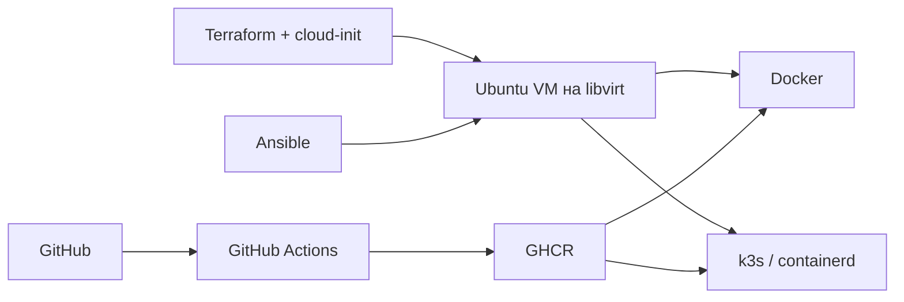

# packet-road

[](https://github.com/m1rua/packet-road/actions/workflows/ci.yml)

Интерактивная CLI для исследования сетевого пути до сайта: DNS, локальный маршрут,
ARP, TCP traceroute, установка TCP-соединения, TLS и HTTP-ответ.

Проект включает Docker-образ, публикацию в GHCR, настройку Ubuntu через Ansible,
запуск в k3s через Helm и мониторинг VM на Prometheus + Grafana.

## Как проходит проверка

1. **DNS** — запрос A к настроенному резолверу, вывод IPv4, CNAME и TTL записей.
2. **Маршрут** — интерфейс, исходный IPv4 и следующий узел по таблице маршрутизации.
3. **ARP** — определение MAC следующего узла в Ethernet-сети.
4. **Traceroute** — TCP SYN с возрастающим TTL и обработка ICMP/TCP-ответов.
5. **TCP и TLS** — обычное соединение с выбранным IP, SNI и проверка сертификата.
6. **HTTP** — GET по HTTP/1.1, статус и заголовки ответа.

Traceroute использует отдельные диагностические пробы. Это не перехват запроса
браузера: TLS и HTTP проверяются следующим, отдельным соединением. Таймауты проб
не означают, что сайт недоступен. DNS TTL относится к кешированию записи,
IP TTL — к числу переходов пакета.

## Локальный запуск

Требуются Linux и Python 3.12 — эта версия используется в CI.
Все настройки вводятся внутри программы; Enter выбирает значение по умолчанию.

```bash
git clone https://github.com/m1rua/packet-road.git
cd packet-road
python3 -m venv .venv
.venv/bin/python -m pip install -r requirements.txt
.venv/bin/python get_info.py
```

Без доступа к raw sockets программа пропускает ARP и traceroute, продолжая
DNS, TCP, TLS и HTTP. Для полного запуска на Linux:

```bash
sudo .venv/bin/python get_info.py
```

Можно указать домен, в том числе IDN, или IPv4. Протокол, порт, путь страницы,
максимальный TTL и таймаут задаются отдельными вопросами.

| Код завершения | Значение |
|---|---|
| `0` | Получен HTTP-ответ 2xx/3xx |
| `1` | Ошибка ввода, DNS или выполнения программы |
| `2` | Ошибка TCP/TLS/HTTP, HTTP 4xx/5xx или неподдерживаемая смена протокола |
| `130` | Прерывание через Ctrl+C или завершение ввода |

HTTP 3xx выводится вместе с `Location`; автоматического перехода нет.
Тело ответа не читается приложением и не отображается. Проверка сертификатов
включена; при HTTPS по IP сертификат должен быть действителен для этого IP.

## Docker и GHCR

Сборка использует две стадии: установка зависимостей в `/opt/venv`, затем перенос
окружения и CLI в runtime на `python:3.12-slim`.

```bash
docker build -t packet-road:local .
docker run --rm -it \
  --cap-drop=ALL --cap-add=NET_RAW \
  packet-road:local
```

Для диагностики из сети хоста на Linux добавь `--network host`:

```bash
docker run --rm -it --network host \
  --cap-drop=ALL --cap-add=NET_RAW \
  packet-road:local
```

Без host-сети CLI видит интерфейс и шлюз контейнера. `NET_RAW` разрешает raw sockets,
но не выбирает сетевой режим. На Docker Desktop поведение host-сети зависит от платформы.

Готовые образы: **`ghcr.io/m1rua/packet-road`**. Для загрузки публичного образа
авторизация не требуется. Выбери существующий тег из
[Packages](https://github.com/m1rua?tab=packages):

```bash
IMAGE_TAG=sha-ff40b74af3a582695aef30022d414c3566d9b82d
docker pull "ghcr.io/m1rua/packet-road:$IMAGE_TAG"
```

CI публикует `sha-<полный SHA коммита>` при push в `main`. Тег `v0.1.0` — ранее
опубликованный релиз: он не обновляется вместе с `main`. Для новой версии выбирай
соответствующий SHA-тег; значение по умолчанию в Helm может указывать на старую сборку.

## Стенд



| Компонент | Ответственность |
|---|---|
| Terraform | Новая VM, диски и cloud-init; подключение к существующей сети libvirt |
| Ansible | Docker, образ CLI, Node Exporter, Prometheus и Grafana provisioning |
| k3s / Helm | Запуск интерактивной CLI в Pod |
| Prometheus | Сбор метрик каждые 15 секунд и вычисление alert rules |
| Grafana | Панели CPU, RAM и диска VM |

Docker и containerd k3s используют разные хранилища образов. `docker pull` не загружает
образ в k3s. CLI запускается отдельно; Ansible скачивает её образ, но не поддерживает
постоянно работающий контейнер packet-road.

## Настройка Ubuntu через Ansible

Ansible запускается на управляющей машине, например Arch. На Ubuntu нужны SSH,
Python 3 и доступ пользователя к sudo.

Из корня репозитория:

```bash
ansible-galaxy collection install -r ansible/requirements.yml
```

Укажи IP и пользователя своей VM в [ansible/inventory.ini](ansible/inventory.ini).
Сохрани локальный Vault:

```bash
EDITOR=nano ansible-vault create ansible/vault.yml
```

Содержимое до шифрования:

```yaml
ghcr_token: "YOUR_GITHUB_CLASSIC_TOKEN"
```

Текущий playbook выполняет вход в GHCR, поэтому ожидает токен с `read:packages`,
хотя публичный образ можно скачивать без входа. `vault.yml` исключён из Git.

```bash
ansible lab -i ansible/inventory.ini -m ping
ansible-playbook -i ansible/inventory.ini ansible/setup.yml \
  --ask-become-pass --ask-vault-pass
```

`BECOME password` — пароль sudo на Ubuntu, `Vault password` — пароль расшифровки.
Для пользователя с passwordless sudo флаг `--ask-become-pass` не нужен.

Playbook доставляет конфиги Prometheus с проверкой через `promtool`, создаёт volume
`grafana_data` и подключает provisioning-файлы к Grafana. Изменение конфигурации
уведомляет handler перезапуска. Повторный запуск без изменений сохраняет состояние.
Версии образов задаются в `vars` playbook. Grafana закреплена по digest nightly-образа:
повторная установка использует то же содержимое. Переход с nightly 13.4 на stable 13.3
может оказаться downgrade базы; сначала сохрани данные и проверь миграцию отдельно.

## Мониторинг и alert

Адреса открываются с машины, имеющей доступ к IP VM:

| Сервис | Адрес |
|---|---|
| Node Exporter | `http://VM_IP:9100/metrics` |
| Prometheus | `http://VM_IP:9090` |
| Grafana | `http://VM_IP:3000` |

Prometheus и Node Exporter работают как systemd-службы Ubuntu. Grafana — Docker-контейнер
в host-сети, источник Prometheus в ней имеет URL `http://127.0.0.1:9090`.
При первом запуске на пустом volume Grafana использует `admin` / `admin` и предлагает
сменить пароль. Dashboards находятся в папке **PacketRoad** и загружаются из JSON.
Изменения provisioned-конфигурации хранятся в Git и доставляются Ansible.

Проверка метрик в Prometheus:

```promql
up{job="node"}
```

Правило **NodeExporterDown** срабатывает, если `up{job="node"} == 0` сохраняется минуту.
Проверка в Ubuntu VM:

```bash
sudo systemctl stop prometheus-node-exporter
# В Prometheus /alerts: Pending, затем Firing примерно через 1–1,5 минуты.
sudo systemctl start prometheus-node-exporter
# После успешного сбора: up=1, alert Inactive.
```

Alert виден в Prometheus и Grafana. Доставка уведомлений через Alertmanager пока
не настроена. Метрики относятся к VM, а не к отдельным этапам работы CLI.

## k3s и Helm

Требуются работающий k3s, Helm, kubectl и kubeconfig с доступом к API кластера.
k3s устанавливается отдельно: текущий Ansible playbook его не устанавливает.
Все команды ниже выполняются на машине с Helm и kubectl.

```bash
export KUBECONFIG="$HOME/.kube/packet-road-lab.yaml"
helm lint helm/packet-road
helm template packet-road helm/packet-road
helm install packet-road helm/packet-road \
  --namespace lab --create-namespace \
  --set-string image.tag=sha-ff40b74af3a582695aef30022d414c3566d9b82d
kubectl wait -n lab --for=condition=Ready pod/packet-road --timeout=120s
kubectl attach -it packet-road -n lab
```

После `attach` вводи домен сразу: пустой Enter выбирает `example.com`.
Chart создаёт один **Pod**, без Deployment и Service. Pod принимает stdin/TTY,
работает с `NET_RAW` и `restartPolicy: Never`. После нормального завершения —
`Completed`, после Ctrl+C с кодом 130 — `Error`. Helm release при этом остаётся.
Для следующего интерактивного запуска удали release и повтори `helm install`:

```bash
helm uninstall packet-road -n lab
```

`hostNetwork: true` использует сеть узла; `false` — отдельную сеть Pod.
Выбор проверяется без запуска ресурсов:

```bash
helm template packet-road helm/packet-road --set hostNetwork=false
```

Чтобы реально изменить сетевой режим, пересоздай Pod/release: это поле нельзя
свободно менять у существующего Pod. Для приватного образа потребуется отдельный
`imagePullSecret`; сохранённый `docker login` к Kubernetes не относится.

## Terraform / libvirt

Запускается на Linux-хосте с KVM и доступом текущего пользователя к `qemu:///system`.
Нужны Terraform >= 1.7, активные pool и NAT/DHCP-сеть `default`. Provider закреплён
на `dmacvicar/libvirt` **0.9.9**; его lock-файл хранится в Git.

Создаётся новая Ubuntu 24.04 LTS VM **packet-road-tf**: 4 ГБ RAM, 2 vCPU, разреженный
диск 20 GiB. Существующая VM не импортируется. Перед созданием проверь место на хосте:
виртуальный размер диска не резервирует свободное физическое пространство.

```bash
cp terraform/terraform.tfvars.example terraform/terraform.tfvars
# В terraform.tfvars укажи содержимое своего публичного SSH-ключа.
terraform -chdir=terraform init -lockfile=readonly
terraform -chdir=terraform validate
terraform -chdir=terraform plan -out=lab.tfplan
# Проверь действия и имена ресурсов перед применением.
terraform -chdir=terraform apply lab.tfplan
terraform -chdir=terraform output
```

Cloud-init настраивает вход по ключу и passwordless sudo. После SSH-подключения
дождись `sudo cloud-init status --wait`. IP можно передать в отдельный inventory:

```bash
terraform -chdir=terraform output -raw ansible_inventory > ansible/inventory.tf.ini
ansible-playbook -i ansible/inventory.tf.ini ansible/setup.yml --ask-vault-pass
```

При геоблокировке Terraform Registry доступен локальный mirror официального
GitHub-релиза provider с проверкой закреплённого SHA256:

```bash
python3 terraform/scripts/install-provider-mirror.py
export TF_CLI_CONFIG_FILE="$PWD/terraform/.terraformrc.mirror"
terraform -chdir=terraform init -lockfile=readonly
```

State, tfvars, планы и локальный mirror исключены из Git. State нужно сохранять:
это связь Terraform с созданными ресурсами. `terraform destroy` удаляет новую VM
и её управляемые диски с данными, а не просто выключает её.

## Проверки и CI

```bash
.venv/bin/python -m ruff check .
.venv/bin/python -m unittest discover -s tests -v
terraform -chdir=terraform fmt -check -recursive
terraform -chdir=terraform test
```

Python-тесты проверяют ввод, права, сопоставление ICMP/TCP-проб и локальные
HTTP/TLS-соединения. Для TLS-тестов нужен исполняемый `openssl`.
Terraform-тесты используют mock-provider и не создают VM.

GitHub Actions выполняет Python, Ansible, Helm и Terraform checks, затем собирает
Docker-образ. Только push в `main` публикует образ в GHCR через `GITHUB_TOKEN`.
PR и ручной запуск выполняют проверки и сборку без публикации. Подключения к личной
VM и автоматического развёртывания в k3s в CI нет.

## Ограничения

- Поддерживается IPv4. DNS выполняется через настроенный резолвер, без ручного
  обхода root → TLD → authoritative.
- Traceroute может не получить конечный ответ из-за лимита TTL или фильтрации.
  Его маршрут может отличаться от обычного соединения; NAT и обратный путь не видны целиком.
- CLI проверяет HTTP/1.1, не выполняет JavaScript и не загружает ресурсы страницы.
- HTTPS-соединение идёт напрямую к выбранному IP; HTTP-прокси из окружения не используется.
- Изменение Python-кода или публикация нового образа не обновляют запущенные контейнеры
  и старые теги в Ansible/Helm автоматически.
- Создание VM через Terraform требует проверки на целевом libvirt. CI проверяет
  конфигурацию и mock-планы, а не реальную загрузку гостевой ОС.
